# As-Is Decision Process — what supports each step today

**Date:** 8 October 2026 · **Diagram 10 of 10** (the 8 data-flow diagrams and the system
architecture diagram follow separately)

The eight steps are the team's As-Is process, taken unchanged from the V-Labs manager deck
(`Research_doc/Presentastaions/`, slide 3). Each step is annotated with what in this
repository now supports it:

- **Tables**: the PostgreSQL tables the evidence comes from
- **Functions**: the SQL functions in `data/schema/03_derive_metrics.sql` that compute it
- **Screens**: where a user sees it (tab number in brackets)
- **Gap**: what the step needs that the data or app does not provide yet (dashed link)

Every name below was checked against the SQL layer and the frontend on 8 October.

## Diagram

Paste the block's contents (without the fence) into mermaid.live, or into Excalidraw's
*Mermaid to Excalidraw* dialog. It follows the Excalidraw-safe rules used in
`system_architecture.md`: plain rectangles, one edge per line, quoted labels, no ` `.
The `classDef` colours may be dropped on Excalidraw import; the structure survives.

```mermaid
flowchart TB
  subgraph S1 ["1 · Business / Portfolio Need"]
    A1["Business objective, portfolio review, market opportunity"]
    T1["Tables: fact_sales, fact_plan (targets, labelled assumption)"]
    F1["Functions: fn_portfolio_kpis, fn_signals (Opportunity signals)"]
    U1["Screens: Home (0) KPI strip"]
    G1["Gap: fact_plan is loaded but no function reads it, so actual vs plan is not shown"]
  end

  subgraph S2 ["2 · Portfolio Performance Review"]
    A2["Revenue, growth, margin, lifecycle, SKU performance"]
    T2["Tables: fact_sales, dim_sku, sku_metrics (snapshot)"]
    F2["Functions: fn_portfolio_kpis, fn_monthly_trend, fn_concentration, fn_sku_performance, fn_sku_segments, fn_portfolio_snapshot"]
    U2["Screens: Home (0), Portfolio Health (1)"]
    G2["Gap: lifecycle stage is classified in the browser (LifecycleHealthPanel), not in SQL"]
  end

  subgraph S3 ["3 · Signal / Issue Identification"]
    A3["Alerts, demand, inventory, customer, market signals"]
    T3["Tables: supplier_notice, launch_gate, sku_cannibalization, fact_forecast, fact_customer_sales, dim_customer"]
    F3["Functions: fn_alerts, fn_signals, fn_forecast_accuracy, fn_customer_insights, fn_customer_category_insights, fn_category_trend"]
    U3["Screens: Signals Board (5), Home alerts and customer panel (0)"]
    G3["Gap: fact_inventory is loaded but not read; competitor and sentiment signals have no source"]
  end

  subgraph S4 ["4 · Investigation & Drill-Down"]
    A4["Region, category, brand, product, SKU, channel"]
    T4["Tables: fact_sales, dim_country (7 countries, 3 regions), dim_channel, dim_category, dim_brand"]
    F4["Functions: fn_regional_fulfillment, fn_region_mix (category and channel), fn_region_sku_shortlist, fn_sku_performance"]
    U4["Screens: Top-Down Drill (6), Home regional panel (0)"]
    G4["Gap: no brand-level rollup; fn_channel_performance and fn_regional_performance feed tests and tax only, no screen"]
  end

  subgraph S5 ["5 · Root Cause & Impact"]
    A5["Financial, demand, supply, inventory, market evidence"]
    T5["Tables: sku_metrics (margin erosion, promo dependency), sku_cannibalization, supplier_notice, fact_opex, sku_fixed_cost, dim_cost_assumption"]
    F5["Functions: fn_sku_rationale (root causes per SKU), fn_pnl, fn_pnl_by_category, fn_cannibalization"]
    U5["Screens: Profitability (3), Analyze panel (9), RCA panel (10), audit drawer"]
    G5["Gap: inventory and market evidence absent; costs below gross margin are labelled assumptions"]
  end

  subgraph S6 ["6 · Decision Assessment"]
    A6["Launch, retain, reposition, assortment, rationalize"]
    T6["Tables: dim_launch, launch_gate, fact_listing, sku_metrics"]
    F6["Functions: fn_launches, fn_launch_gates, fn_launch_summary, fn_sku_rationale (action per SKU), fn_sku_segments, fn_assortment, fn_assortment_summary, fn_listing_gaps"]
    U6["Screens: Launch Readiness (2), SKU Rationalization (4, 9, 10), Assortment (8)"]
    G6["Gap: launch lead region and year-1 plan are labelled assumptions"]
  end

  subgraph S7 ["7 · Scenario / Trade-Off"]
    A7["Alternative actions, expected revenue, margin, risk"]
    T7["Tables: rationalization_scenario (snapshot), fact_opex, sku_fixed_cost"]
    F7["Functions: fn_rationalization_scenarios, fn_sku_rationale (margin without the SKU), fn_pnl (seeds the P&L what-if)"]
    U7["Screens: Profitability what-if (3), Revenue Tail Risk (4), Simulate (10)"]
    G7["Gap: no demand-transfer model (TODO O5); fact_price is loaded but not read, so no price what-if on real prices"]
  end

  subgraph S8 ["8 · Decision & Action"]
    A8["Approval, ownership, execution"]
    T8["Tables: dim_launch.owner_role, launch_gate.reviewer_role (launches only)"]
    F8["Functions: none; expected vs actual exists only as fn_launch_summary and fn_forecast_accuracy"]
    U8["Screens: Task Tracker (11), browser session only"]
    G8["Gap: no decision or approval table; tracker tasks are lost on reload"]
  end

  A1 --> A2
  A2 --> A3
  A3 --> A4
  A4 --> A5
  A5 --> A6
  A6 --> A7
  A7 --> A8

  T1 --> F1
  F1 --> U1
  U1 --> A1
  G1 -.-> A1

  T2 --> F2
  F2 --> U2
  U2 --> A2
  G2 -.-> A2

  T3 --> F3
  F3 --> U3
  U3 --> A3
  G3 -.-> A3

  T4 --> F4
  F4 --> U4
  U4 --> A4
  G4 -.-> A4

  T5 --> F5
  F5 --> U5
  U5 --> A5
  G5 -.-> A5

  T6 --> F6
  F6 --> U6
  U6 --> A6
  G6 -.-> A6

  T7 --> F7
  F7 --> U7
  U7 --> A7
  G7 -.-> A7

  T8 --> F8
  F8 --> U8
  U8 --> A8
  G8 -.-> A8

  classDef step fill:#1f2937,color:#ffffff,stroke:#111827
  classDef tbl fill:#dbeafe,color:#1e3a8a,stroke:#3b82f6
  classDef fn fill:#dcfce7,color:#14532d,stroke:#22c55e
  classDef scr fill:#fef9c3,color:#713f12,stroke:#eab308
  classDef gap fill:#fee2e2,color:#7f1d1d,stroke:#ef4444,stroke-dasharray:4 3
  class A1,A2,A3,A4,A5,A6,A7,A8 step
  class T1,T2,T3,T4,T5,T6,T7,T8 tbl
  class F1,F2,F3,F4,F5,F6,F7,F8 fn
  class U1,U2,U3,U4,U5,U6,U7,U8 scr
  class G1,G2,G3,G4,G5,G6,G7,G8 gap
```

## Reading it

Coverage by step, strongest to weakest:

| Step | Coverage | Why |
| --- | --- | --- |
| 2 Performance Review | Strong | Every figure is a windowed SQL function over `fact_sales` |
| 4 Investigation & Drill-Down | Strong | Region, category, channel and SKU drill are live; brand only per SKU |
| 6 Decision Assessment | Strong | Launch, rationalize and assortment decisions each have a function |
| 3 Signal / Issue Identification | Partial | Internal signals live; inventory unused; competitor and sentiment out of scope |
| 5 Root Cause & Impact | Partial | Per-SKU root causes live; inventory and market evidence missing |
| 7 Scenario / Trade-Off | Partial | Removal effects are real, but demand transfer is not modelled |
| 1 Business / Portfolio Need | Weak | Targets exist in `fact_plan` but nothing reads them |
| 8 Decision & Action | Weak | No table records a decision, its owner or its outcome |

Three tables are loaded but read by no function: **`fact_plan`**, **`fact_inventory`** and
**`fact_price`**. Wiring them closes the biggest gaps in steps 1, 3, 5 and 7 without
generating new data.
