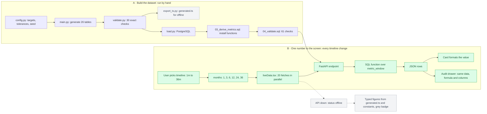
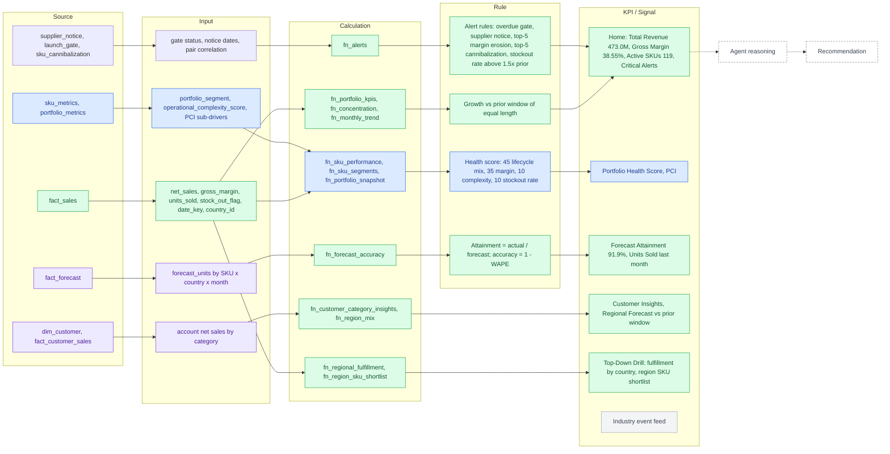
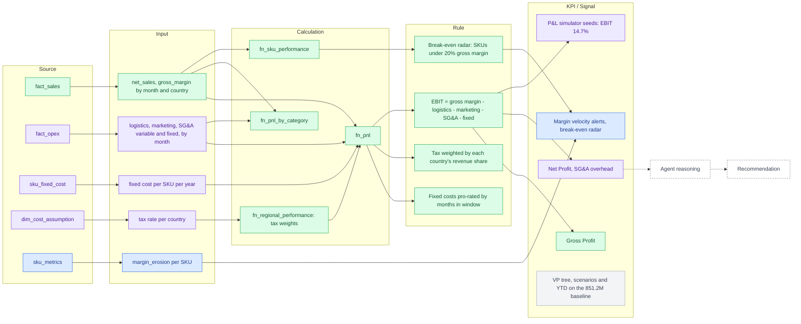
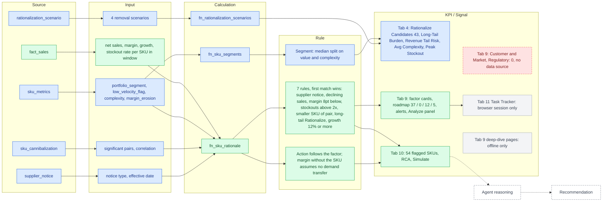
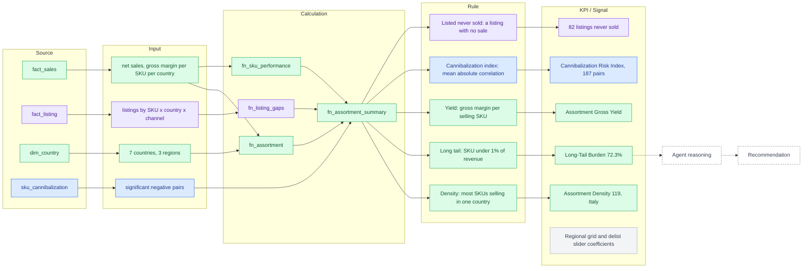
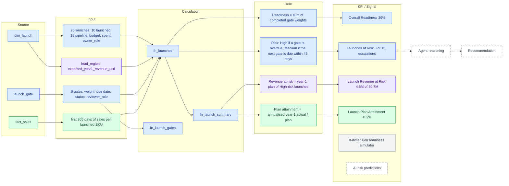
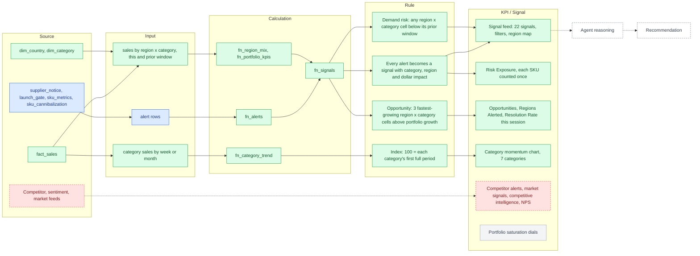
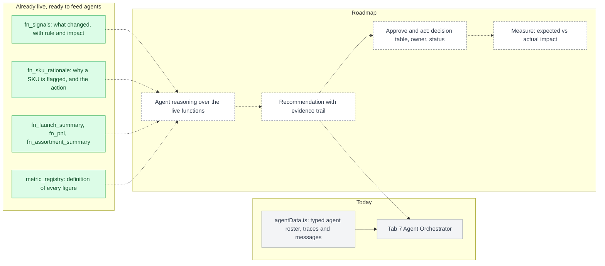

# System Architecture and Data Flow — by thread

**Date:** 8 October 2026 · supersedes the three diagrams in `system_architecture.md`
(20 September), whose "Now" state had no database and no API.

Ten diagrams:

| # | Diagram | Answers |
| --- | --- | --- |
| 1 | System architecture | What the parts are and how they connect |
| 2 | Data flow overview | How the dataset is built, and how one number reaches a screen |
| 3–9 | One data flow per thread | For each thread: source → input → calculation → rule → KPI/signal → (agent reasoning → recommendation) |
| 10 | As-Is process | In [`as_is_process_lineage.md`](as_is_process_lineage.md): the team's 8 As-Is steps and what supports each today |

The thread diagrams use the lineage chain from the team deck's *Explain* pillar
(`Research_doc/Presentastaions/`, slide 9): **Source → Input → Calculation → Rule →
KPI / Signal → Agent reasoning → Recommendation**. The last two links are dashed in every
thread: no agent computes anything today. Each thread is also tagged with its decision stage
from the deck's To-Be journey (Detect → Diagnose → Assess → Correlate → Recommend →
Approve / Act → Measure).

Figures quoted in boxes are for the 12-month window ending 2025-12-31 and were read from the
API on 8 October.

## Status legend (all diagrams)

| Colour | Status | Meaning |
| --- | --- | --- |
| Green | **Live** | Computed in SQL over the selected timeline window |
| Blue | **Snapshot** | Computed once over the full 24 months; ignores the timeline selector |
| Purple | **Assumption** | Generated input, labelled as an assumption (costs, plans, gate weights) |
| Grey | **Typed** | Hand-written in the frontend; shown only offline, or not yet replaced |
| Red, dashed | **No source** | Nothing in the data can supply it; the screen says so |
| White, dashed | **Roadmap** | Planned, not built |

## Using these diagrams

Paste a block's contents (without the fence) into mermaid.live, or into Excalidraw's
*Mermaid to Excalidraw* dialog. All blocks follow the Excalidraw-safe rules: plain
rectangles, one edge per line, quoted labels, no ` `. Excalidraw may drop the `classDef`
colours; the structure survives.

---
 
## 1 · System architecture

Six layers, top to bottom. From the calculation layer down, boxes are grouped by thread.

```mermaid
flowchart TB
  subgraph L1 ["Layer 1 · Data sources"]
    GEN["Python generator: data/generator, 20 modules, SEED 20260909"]
    CSV["data/output: 26 CSV tables"]
    EXT["External feeds: competitor, NPS, client ERP and APIs"]
  end

  subgraph L2 ["Layer 2 · Validate and load"]
    VAL["validate.py: 30 exact checks"]
    LOAD["load.py: COPY 26 tables in FK order"]
    SQLV["04_validate.sql: 61 checks"]
  end

  subgraph L3 ["Layer 3 · Warehouse: PostgreSQL 17, port 5433"]
    CORE["Core: dim_date, dim_sku, dim_brand, dim_category, dim_country, dim_channel, dim_supplier, sku_supplier, fact_sales 357,471 rows"]
    SNAP["Snapshots: sku_metrics, sku_cannibalization, portfolio_metrics, rationalization_scenario"]
    OCT7["7 Oct tables: dim_customer, fact_customer_sales, fact_listing, fact_forecast, dim_launch, launch_gate, supplier_notice"]
    ASSUME["Assumption tables: dim_cost_assumption, fact_opex, sku_fixed_cost"]
    UNREAD["Loaded, not yet read: fact_plan, fact_inventory, fact_price"]
  end

  subgraph L4 ["Layer 4 · Calculation: 03_derive_metrics.sql + metric_registry"]
    C1["T1 Portfolio Health: fn_portfolio_kpis, fn_concentration, fn_monthly_trend, fn_sku_performance, fn_sku_segments, fn_portfolio_snapshot, fn_alerts, fn_forecast_accuracy, fn_customer_category_insights, fn_region_mix, fn_regional_fulfillment, fn_region_sku_shortlist"]
    C2["T2 Profitability: fn_pnl, fn_pnl_by_category, fn_regional_performance"]
    C3["T3 SKU Rationalization: fn_sku_rationale, fn_rationalization_scenarios, fn_cannibalization"]
    C4["T4 Assortment: fn_assortment_summary, fn_assortment, fn_listing_gaps"]
    C5["T5 Launch: fn_launches, fn_launch_gates, fn_launch_summary"]
    C6["T6 Signals: fn_signals, fn_category_trend"]
    WIN["metric_window: trailing 1, 3, 6, 12, 24, 36 months, prior window of equal length"]
  end

  subgraph L5 ["Layer 5 · API: FastAPI, backend/app/main.py, port 8000"]
    API["32 GET endpoints, each calls one SQL function, no arithmetic"]
    TEST["backend/tests: 37 tests, breakdowns sum to the headline"]
  end

  subgraph L6 ["Layer 6 · Frontend: React + Vite"]
    CTX["liveData.tsx: one fetch per timeline period, shared context"]
    LAZY["Screen-specific fetches: regional fulfillment, region top SKUs, category trend"]
    VP["VP Product Management"]
    PM["Product Manager"]
    PR["Pricing and Margin Partner"]
    TABS["12 tabs: T1 0 1 6, T2 3, T3 4 9 10 11, T4 8, T5 2, T6 5, T7 7"]
    AUDIT["Audit drawer: formula, columns and provenance per card"]
    OFF["Offline fallback: generated.ts and typed sample, grey badge"]
  end

  AGENTS["Agents and LLM reasoning"]
  O19["Role-based data access O19"]
  FIVE["5-tab consolidation O8"]

  GEN --> CSV
  CSV --> VAL
  VAL --> LOAD
  LOAD --> CORE
  LOAD --> SNAP
  LOAD --> OCT7
  LOAD --> ASSUME
  LOAD --> UNREAD
  CORE --> SQLV
  EXT -.-> CORE

  CORE --> C1
  SNAP --> C1
  OCT7 --> C1
  CORE --> C2
  ASSUME --> C2
  SNAP --> C3
  OCT7 --> C3
  CORE --> C4
  OCT7 --> C4
  OCT7 --> C5
  C1 --> C6
  WIN --> C1

  C1 --> API
  C2 --> API
  C3 --> API
  C4 --> API
  C5 --> API
  C6 --> API
  API --> TEST

  API --> CTX
  API --> LAZY
  CTX --> TABS
  LAZY --> TABS
  CTX --> AUDIT
  OFF -.-> TABS
  VP --> TABS
  PM --> TABS
  PR --> TABS

  API -.-> AGENTS
  AGENTS -.-> TABS
  O19 -.-> API
  FIVE -.-> TABS

  classDef live fill:#dcfce7,color:#14532d,stroke:#16a34a
  classDef snap fill:#dbeafe,color:#1e3a8a,stroke:#2563eb
  classDef assume fill:#ede9fe,color:#4c1d95,stroke:#7c3aed
  classDef typed fill:#f3f4f6,color:#374151,stroke:#9ca3af
  classDef nosrc fill:#fee2e2,color:#7f1d1d,stroke:#ef4444,stroke-dasharray:4 3
  classDef road fill:#ffffff,color:#374151,stroke:#6b7280,stroke-dasharray:4 3
  class C1,C2,C3,C4,C5,C6,WIN,API,CTX,LAZY live
  class SNAP snap
  class ASSUME assume
  class OFF typed
  class EXT,UNREAD nosrc
  class AGENTS,O19,FIVE road
```

**Notes**

- **All arithmetic lives in SQL.** FastAPI only calls functions, and the frontend only
  formats. Exceptions are named in the thread diagrams: the Portfolio Health Score weighting
  and the P&L what-if sliders still compute in the browser.
- **Three tables are loaded but read by nothing:** `fact_plan`, `fact_inventory`,
  `fact_price`. See diagram 10 for which As-Is steps they would close.
- **Offline is deliberate.** The static Vercel build has no API, so every screen keeps a
  typed fallback and the grey badge says so.

---

## 2 · Data flow overview

Two chains: how the dataset is built (once, by hand), and how a number reaches a card (on
every timeline change).

**Notes**

- Growth always compares with the prior window of equal length. The data holds 24 months,
  so 36 is clamped and growth is NULL when no full prior window exists. It is never invented.
- Snapshot functions (`fn_sku_segments`, `fn_portfolio_snapshot`,
  `fn_rationalization_scenarios`, `fn_launches`) are fetched once and ignore the timeline.

---

## 3 · Thread 1 — Portfolio Health · stage: Detect

Tabs 0 Home, 1 Portfolio Health, 6 Top-Down Drill.

**Notes**

- The Health Score combines live inputs (growth, margin, stockout rate) with snapshot
  complexity. Its 45/35/10/10 weighting runs in the browser (`LifecycleHealthPanel`), and the
  weights are a judgment call, which the drawer states.
- The forecast and customer tables are generated (purple). Their figures are real
  calculations over generated inputs.
- The Home industry event feed is illustrative and typed.

---

## 4 · Thread 2 — Profitability · stage: Diagnose

Tab 3.

**Notes**

- Everything below gross profit rests on labelled cost assumptions. Net Profit and SG&A are
  real calculations over assumed inputs, which is why they are purple, not green.
- The P&L what-if sliders seed from `fn_pnl`, then recompute in the browser as the user moves
  them.

---

## 5 · Thread 3 — SKU Rationalization · stage: Assess

Tabs 4, 9 Rationalisation Home, 10 SKU Drill Down, 11 Task Tracker.

**Notes**

- `fn_sku_rationale` mixes windowed inputs (growth, margin, stockouts) with snapshot ones
  (segment, cannibalization). So the classification moves with the timeline: Reposition is
  empty at 12 months and fills at 3 months.
- `supplier_notice` is generated. It is drawn blue because it is a fixed list, not a window.

---

## 6 · Thread 4 — Assortment · stage: Assess

Tab 8.

**Notes**

- A 72.3% long tail is expected with 119 SKUs, where the average share is 0.84%. The drawer
  says so.
- The regional grid reads `generated.ts`, a real export but not live, and the delist slider
  uses typed coefficients. Both are grey.

---

## 7 · Thread 5 — Launch Readiness · stage: Assess

Tab 2.

**Notes**

- Launch data is stated as of 2025-12-31, not windowed, so it is drawn blue. Plan
  attainment is green because its actual side is computed from `fact_sales`.
- Gate weights, lead region and the year-1 plan are generated assumptions, each labelled as
  such.

---

## 8 · Thread 6 — Market Signals · stage: Detect and Correlate

Tab 5.

**Notes**

- This is the deck's **Correlate** stage. Each signal carries the rule that fired it, and the
  audit drawer shows the same rows, which together make up the provenance trail.
- Resolution Rate counts only signals resolved on screen this session. No resolution history
  table exists.

---

## 9 · Thread 7 — Agent Orchestrator · stage: Recommend

Tab 7. No computed figures exist on this tab; the diagram shows what would connect it.

**Notes**

- The team deck marks Agent Orchestrator as PRIMARY for all three personas. Today it shows
  typed content only.
- **Measure** has two live precedents to build on: Launch Plan Attainment (102%) and Forecast
  Attainment (91.9%). Both are expected-vs-actual comparisons computed in SQL.
